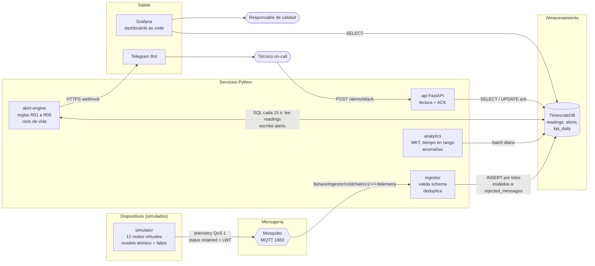
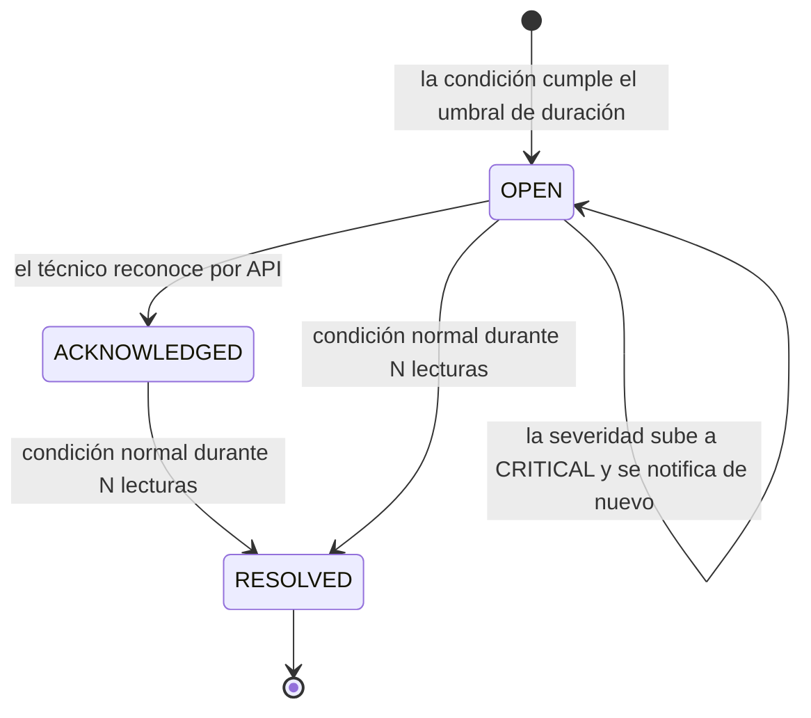

# Arquitectura — ColdChain Monitor

| | |
|---|---|
| Estado | Fase 1 — diseño (v0.1) |
| Fecha | 2026-11-18 |
| Repositorio | github.com/GSJL06/iot-cold-chain-monitor |

> **Aviso.** Proyecto independiente de portafolio. Todos los datos son sintéticos. No contiene código, datos, nombres de clientes ni credenciales de empleadores anteriores.

## 1. Problema

Vacunas, biológicos y reactivos deben mantenerse dentro de un rango de temperatura (por ejemplo, 2–8 °C en refrigeración). Una excursión no detectada a tiempo implica pérdida de producto e incumplimiento de las buenas prácticas de distribución (GDP).

Los sistemas básicos fallan de dos maneras:

1. **Falsas alarmas.** Una puerta abierta 90 segundos dispara el mismo aviso que un compresor averiado. El equipo aprende a ignorar las alertas.
2. **Fallos silenciosos.** Un nodo que deja de transmitir no genera ninguna alarma de temperatura: "sin alertas" parece "todo bien".

**Qué demuestra este proyecto:** un pipeline de telemetría con alertas por duración (no solo por umbral), detección de dispositivos mudos, ciclo de vida de alertas y KPIs de cumplimiento, reproducible con `docker compose up`.

## 2. Usuarios

| Persona | Necesidad | Cómo la resuelve el sistema |
|---|---|---|
| Responsable de calidad / farmacia | Demostrar que el producto estuvo en rango y ver excursiones | Dashboard Grafana, tiempo en rango, MKT diario, historial de alertas |
| Técnico on-call | Saber qué falló y dónde, con contexto para diagnosticar | Notificación con rssi, batería, `on_backup_power` y `last_seen`; ACK por API |
| Revisor técnico (reclutador, ingeniero) | Verificar el trabajo en minutos | `docker compose up`, README con métricas, CI verde, tests |

## 3. Alcance

**Dentro de v1**

- Simulador de 12 dispositivos en 3 sitios, con las 3 clases de almacenamiento y escenarios de fallo etiquetados.
- Ingesta MQTT con validación por contrato y almacenamiento de series temporales.
- Motor de alertas con 6 reglas, histéresis y ciclo de vida.
- API REST (lectura + ACK) y dashboards Grafana provisionados como código.
- Analítica diaria: tiempo en rango, MKT y puntuación de anomalías.

**Fuera de v1**

- Hardware real, firmware y FOTA.
- Multi-tenant, usuarios y roles de aplicación.
- App móvil, facturación, Kubernetes.
- TLS en MQTT y despliegue público (documentados como mejoras).

## 4. Arquitectura

**Principios de diseño**

1. **Contrato primero.** El JSON Schema (`schemas/`) es la fuente de verdad; simulador, ingestor y tests lo comparten.
2. **At-least-once + escrituras idempotentes.** MQTT QoS 1 puede duplicar; la clave `(device_id, ts)` lo absorbe.
3. **La base de datos es el estado.** Los servicios no guardan estado propio; reiniciar cualquiera no pierde alertas.
4. **Silencio = fallo.** El estado "offline" se decide por ausencia de lecturas, no solo por el LWT del broker.

## 5. Servicios

| Servicio | Responsabilidad | Entrada | Salida | Prioridad |
|---|---|---|---|---|
| `simulator` | Genera telemetría con modelo térmico (ciclos de compresor, ruido) e inyecta fallos con semilla fija | `config/` (flota, escenarios) | MQTT `telemetry` y `status` | Must |
| `mosquitto` | Broker MQTT con autenticación y ACL | MQTT | MQTT | Must |
| `ingestor` | Valida contra schema, rechaza con motivo, deduplica, inserta por lotes | MQTT (suscripción compartida) | `readings`, `device_status`, `rejected_messages` | Must |
| `timescaledb` | Series temporales, compresión y retención | SQL | SQL | Must |
| `alert-engine` | Evalúa reglas R01–R06 cada 15 s, abre/escala/resuelve alertas, notifica | `readings`, `device_status` | `alerts`, Telegram | Must |
| `grafana` | Dashboards de flota, dispositivo y alertas | SQL (rol solo lectura) | UI | Must |
| `api` | REST con OpenAPI: dispositivos, lecturas, alertas, KPIs, ACK | SQL | JSON | Should |
| `analytics` | Job diario: tiempo en rango, MKT, puntuación de anomalías | `readings` | `kpi_daily`, `anomaly_scores` | Could |

**Por qué el motor de alertas lee la base de datos y no el stream:** reiniciar el servicio no pierde el estado de las ventanas (por ejemplo "fuera de rango desde hace 7 min"), las reglas por duración se expresan en SQL y el diseño se prueba con datos sembrados. Coste: latencia de hasta 15 s, aceptable para reglas de minutos. Ver `docs/adr/0001-arquitectura-base.md`.

## 6. Protocolo

MQTT 3.1.1/5 sobre TCP 1883 (local, sin TLS en v1). Topics, QoS, payloads y validaciones: `docs/mqtt-contract.md`.

## 7. Modelo de datos

| Tabla | Clave | Columnas principales |
|---|---|---|
| `sites` | `site_id` | `name`, `city` |
| `devices` | `device_id` | `site_id`, `label`, `storage_class`, `min_c`, `max_c`, `fw_version` |
| `readings` (hypertable) | `(device_id, ts)` | `received_at`, `seq`, `temp_c`, `humidity_pct`, `rssi_dbm`, `battery_pct`, `on_backup_power` |
| `device_status` | `device_id` | `state`, `last_seen`, `last_status_ts` |
| `alerts` | `alert_id` | `device_id`, `rule_id`, `severity`, `state`, `opened_at`, `acked_at`, `resolved_at`, `context` (jsonb) |
| `rejected_messages` | `id` | `received_at`, `topic`, `payload`, `reason` |
| `kpi_daily` | `(device_id, day)` | `time_in_range_pct`, `mkt_c`, `excursion_count`, `max_excursion_min` |
| `anomaly_scores` | `(device_id, ts)` | `score`, `model_version` |

**Clases de almacenamiento** (rangos configurables, ver `docs/alert-rules.md`):

| Clase | Rango objetivo |
|---|---|
| `REFRIGERATED` | 2,0 a 8,0 °C |
| `FROZEN` | −25,0 a −15,0 °C |
| `ULTRA_FROZEN` | −90,0 a −60,0 °C |

Retención propuesta: 90 días de lecturas crudas, compresión a partir de 7 días [SUPUESTO].

## 8. Alertas

Reglas, parámetros y escenarios de validación: `docs/alert-rules.md`.

**Ciclo de vida de una alerta** (una alerta abierta por par dispositivo + regla):

Se notifica al abrir, al escalar y al resolver. Un ACK detiene los recordatorios.

## 9. Requisitos no funcionales (objetivos de diseño, aún no medidos)

| # | Objetivo | Cómo se mide | Se verifica en |
|---|---|---|---|
| 1 | Stack arriba y datos en el dashboard en ≤ 3 min desde un clon limpio | Cronómetro y pasos del README | Fase 4 |
| 2 | Latencia publicación → fila en BD: p95 < 2 s a 20 msg/s | `received_at − ts` y script de carga | Fase 4 |
| 3 | 0 huecos de `seq` en 1 h de simulación con QoS 1 | Consulta de huecos por dispositivo | Fase 4 |
| 4 | Alerta abierta ≤ 30 s después de cumplirse la condición | Test con reloj simulado | Fases 3–4 |
| 5 | En 24 h simuladas (semilla fija) con 10 fallos reales y 30 aperturas de puerta: recall 100 % y precisión ≥ 90 % | Test de integración con escenario etiquetado | Fase 4 |
| 6 | Cobertura ≥ 70 % en `alert-engine` y CI en verde | `pytest-cov` + GitHub Actions | Fase 3 |

## 10. Seguridad básica (diseño)

- Secretos solo en `.env` (ignorado por git). `.env.example` lleva placeholders.
- Mosquitto con `allow_anonymous false`, un usuario por servicio y ACL: cada dispositivo publica solo en su propio topic.
- Roles de BD de mínimo privilegio: `ingestor` (INSERT), `alert_engine` (SELECT + INSERT/UPDATE en `alerts`), `api_ro` y `grafana_ro` (SELECT).
- API: cabecera `X-API-Key` para el ACK; el resto es solo lectura.
- Imágenes Docker con versión fija. Puertos publicados solo en localhost: 1883, 3000 (Grafana), 8000 (API).
- Modelo de amenazas STRIDE básico en Fase 3.

## 11. Riesgos

| Riesgo | Mitigación |
|---|---|
| Alcance excesivo para 4–6 semanas a 8–10 h/semana | MoSCoW: `analytics` y despliegue público son opcionales; el MVP cierra sin ellos |
| Datos sintéticos poco realistas | Modelo térmico con ciclos y ruido; escenarios etiquetados; limitaciones documentadas |
| Fuga de propiedad intelectual de empleadores anteriores | Nombres, topics y formatos propios; sin firmware, IPs, MACs ni identificadores reales |
| Dependencia de Telegram | Notificador detrás de una interfaz; si falla, la alerta queda en `alerts` y Grafana |
| Reloj de dispositivo desviado | Se guardan `ts` y `received_at`; se rechazan `ts` futuros a más de 5 min |
| Deriva lenta del sensor (sin salto brusco) | Fuera del alcance de las reglas; la puntuación de anomalías de `analytics` la cubre en parte |

## 12. Glosario

| Término | Definición |
|---|---|
| MQTT | Protocolo de mensajería publicar/suscribir para dispositivos con poco ancho de banda |
| Broker | Servidor que recibe los mensajes MQTT y los reparte a los suscriptores |
| QoS 1 | Entrega "al menos una vez": puede haber duplicados, no pérdidas |
| LWT | Last Will and Testament: mensaje que el broker publica si un cliente se desconecta sin avisar |
| Hypertable | Tabla de TimescaleDB particionada automáticamente por tiempo |
| Excursión | Periodo con temperatura fuera del rango objetivo |
| MKT | Mean Kinetic Temperature: temperatura única equivalente al efecto térmico acumulado de un historial |
| Histéresis | Umbral distinto para abrir y para cerrar una alerta, que evita que parpadee |
| ADR | Architecture Decision Record: registro corto de una decisión y sus alternativas |
