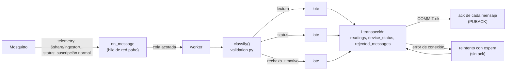

# Diseño del ingestor — ColdChain Monitor

| | |
|---|---|
| Estado | Fase 4C — diseño (v0.1) |
| Fecha | 2026-11-26 |
| Relacionados | `docs/mqtt-contract.md` (secciones 2, 4 y 5), `docs/architecture.md`, `docs/engineering-practices.md` (secciones 5 y 6), `docs/adr/0006-ingestor-at-least-once.md` |
| Contratos | `schemas/telemetry.v1.schema.json`, `schemas/status.v1.schema.json` |

## 1. Objetivo y garantías

El ingestor lleva los mensajes MQTT a TimescaleDB: valida, clasifica, deduplica y escribe por lotes.

| Garantía | Cómo se logra |
|---|---|
| **Sin pérdida** ante reinicio del ingestor o caída de la base de datos | Sesión MQTT persistente, QoS 1 y confirmación manual (`manual_ack`) después del `COMMIT` |
| **Sin duplicados** en `readings` | Clave primaria `(device_id, ts)` y `ON CONFLICT DO NOTHING` |
| **Ningún mensaje se descarta en silencio** | Todo mensaje termina en `readings`, `device_status` o `rejected_messages` con su motivo, salvo el límite de la sección 9 (se cuenta y se registra) |
| **Un mensaje malo no bloquea al resto** | Aislamiento de mensajes venenosos (sección 6) |

Semántica de entrega: *al menos una vez* en el transporte, más deduplicación en la base de datos. El efecto sobre `readings` es el de una entrega exacta.

## 2. Estructura

```
services/ingestor/
├── Dockerfile
├── README.md
├── requirements.txt          (ya existe, versiones fijadas)
└── src/ingestor/
    ├── __init__.py
    ├── __main__.py           # python -m ingestor
    ├── config.py             # variables de entorno y validación
    ├── logs.py               # logs JSON, una línea por evento
    ├── validation.py         # clasificación pura de un mensaje
    ├── directory.py          # caché de dispositivos conocidos
    ├── store.py              # SQL (funciones que reciben una conexión)
    ├── pipeline.py           # lote, límite de rechazos, aislamiento, bucle del worker
    ├── mqtt_io.py            # adaptador paho: conexión, suscripciones, ack
    ├── health.py             # latido y comprobación para Docker
    └── app.py                # montaje y señales
```

| Módulo | Depende de red o BD | Se prueba con |
|---|---|---|
| `validation`, `directory`, `config`, `logs` | No | pytest sin servicios |
| `pipeline` | No (recibe `store` y `mqtt` falsos) | pytest sin servicios |
| `store` | Base de datos | pytest `-m integration` (transacción con `ROLLBACK`) |
| `mqtt_io`, `app` | Broker y BD | Verificación en vivo (sección 12) |

## 3. Flujo



1. `on_message` (hilo de red de paho) solo mete el mensaje en una cola. No toca la base de datos.
2. El worker forma un lote: se cierra al llegar a `BATCH_MAX_SIZE` mensajes o a `BATCH_MAX_WAIT_MS` desde el primero.
3. Clasifica cada mensaje, escribe todo en **una transacción** y, tras el `COMMIT`, confirma cada mensaje al broker.

## 4. Clasificación (`validation.classify`)

Función pura: recibe topic, bytes, directorio de dispositivos y hora actual; devuelve una lectura, un estado o un rechazo. **El primer motivo que aplica gana**, en este orden:

| # | Comprobación | Motivo |
|---|---|---|
| 1 | El topic no cumple `coldchain/v1/{site}/{device}/(telemetry\|status)` con los patrones de `mqtt-contract.md` (sección 1) | `topic_mismatch` |
| 2 | Payload mayor de 4096 bytes, no UTF-8, no JSON, no es un objeto, o contiene `NaN` o `Infinity` | `schema_invalid` |
| 3 | `schema` es una cadena distinta de la versión del topic (`telemetry.v1` o `status.v1`) | `unsupported_schema` |
| 4 | No cumple el JSON Schema, o `seq` > 2 147 483 647 | `schema_invalid` |
| 5 | `device_id` del payload distinto del topic | `topic_mismatch` |
| 6 | `device_id` no existe en `devices` | `unknown_device` |
| 7 | `ts` más de 300 s en el futuro respecto a la hora del servidor | `clock_skew` |

Notas de diseño, comprobadas con un prototipo:

- El paso 3 va antes que el 4 para que un `telemetry.v2` se clasifique como `unsupported_schema` y no como `schema_invalid`. Un `schema` ausente o que no es cadena cae en el paso 4.
- `NaN` e `Infinity` los acepta `json.loads` de Python y el JSON Schema los deja pasar en un campo `number` con rango. PostgreSQL los rechaza después con un `CHECK`, y un lote entero fallaría para siempre. Se cortan en el paso 2 con `parse_constant`. Un `1e999` se convierte en infinito y lo detiene el rango del schema.
- El schema define `seq` como entero sin máximo, y la columna es `integer`. El límite de 2 147 483 647 se aplica en código. Un `seq` o `rssi_dbm` como `5.0` pasa el schema y se convierte con `int()` antes de escribir.
- Los mismos pasos, motivos y orden valen para `status.v1`. El `ts` de un `status` se valida igual (el LWT lleva el `ts` de la conexión, siempre en el pasado).
- Un topic con identificadores que no cumplen los patrones se clasifica como `topic_mismatch`: el contrato no define un motivo propio y se evita ampliar la tabla.

Resultado de una lectura válida: `device_id`, `ts` (UTC, con milisegundos si vienen), `seq`, `temp_c`, `humidity_pct` (o nulo), `rssi_dbm`, `battery_pct`, `on_backup_power`. El campo `fw` no se guarda en `readings`.

Payload guardado en un rechazo: texto UTF-8 con caracteres inválidos sustituidos, `\x00` sustituido por `\ufffd` (PostgreSQL no admite NUL en `text`) y truncado a 4096 caracteres.

## 5. Escritura en la base de datos (`store.py`)

Rol `ingestor`: `SELECT` en `sites` y `devices`; `SELECT, INSERT` en `readings`; `INSERT` en `rejected_messages`; `SELECT, INSERT, UPDATE` en `device_status`. Todas las consultas están parametrizadas.

Las funciones de `store` reciben una conexión y **no** hacen `COMMIT`: lo hace el worker. Así las pruebas de integración usan `ROLLBACK` y no ensucian la base de datos.

```sql
-- Lecturas: una sentencia por lote. Devuelve en rowcount las filas realmente insertadas.
INSERT INTO readings (ts, device_id, seq, temp_c, humidity_pct, rssi_dbm, battery_pct, on_backup_power)
SELECT * FROM unnest(
    %s::timestamptz[], %s::text[], %s::integer[], %s::float8[],
    %s::float8[], %s::smallint[], %s::real[], %s::boolean[])
ON CONFLICT (device_id, ts) DO NOTHING;

-- Rechazos
INSERT INTO rejected_messages (topic, payload, reason) VALUES (%s, %s, %s);

-- Última actividad: una fila por dispositivo y lote, con la hora del servidor
INSERT INTO device_status (device_id, state, last_seen) VALUES (%s, 'online', now())
ON CONFLICT (device_id) DO UPDATE
    SET last_seen = GREATEST(device_status.last_seen, EXCLUDED.last_seen);

-- Estado publicado por el dispositivo, aplicado en orden de llegada
INSERT INTO device_status (device_id, state, last_status_ts) VALUES (%s, %s::device_state, %s)
ON CONFLICT (device_id) DO UPDATE
    SET state = EXCLUDED.state, last_status_ts = EXCLUDED.last_status_ts;
```

- Duplicados del lote = mensajes de lectura − `rowcount`. Un duplicado dentro del mismo lote lo absorbe también `DO NOTHING`.
- Las columnas de humedad llegan como lista de `None` en un lote de ultracongeladores; el `::float8[]` explícito evita que psycopg no sepa inferir el tipo.
- `received_at` usa su valor por defecto (`now()`), la hora del servidor de base de datos.
- `last_seen` usa la hora del servidor, no el `ts` del dispositivo: con el backfill del simulador los `ts` son antiguos, pero el dispositivo está activo ahora.

### `device_status.state`

El estado `online` u `offline` sale **solo** de los mensajes `status`, aplicados en orden de llegada (el último gana). No se compara por `ts`: el LWT lleva el `ts` de la conexión, anterior al del mensaje `online` publicado después, y una comparación por `ts` descartaría el `offline` legítimo. Una lectura recibida de un dispositivo sin fila crea la fila con `online`. R03 no usa `state`: se basa en el silencio de lecturas (`alert-rules.md`).

## 6. Fallos y mensajes venenosos

| Situación | Comportamiento |
|---|---|
| Error de conexión o de servidor (`OperationalError`, `InterfaceError`, base de datos caída) | `ROLLBACK`, **sin ack**, espera 1, 2, 4… hasta 10 s y reintenta el mismo lote. El broker mantiene los mensajes sin confirmar |
| Error de datos o de restricción en el lote (`DataError`, `IntegrityError`) | `ROLLBACK` y reproceso mensaje a mensaje, cada uno en su transacción. El que falla se guarda como `schema_invalid` y se registra `poison_isolated`. El resto sigue |
| Parada (SIGTERM, SIGINT) | Deja de aceptar mensajes, cierra y escribe el lote en curso, confirma y desconecta con `DISCONNECT` limpio (la sesión persiste) |
| Reinicio tras un fallo | El broker reentrega los mensajes sin confirmar; los duplicados los absorbe la clave `(device_id, ts)` |

## 7. Sesión MQTT y confirmación manual

- Cliente: `client_id` fijo (`INGESTOR_ID`, por defecto `ingestor`), usuario `ingestor`, MQTT 3.1.1, `clean_session=False`, keepalive 60 s, reconexión automática (`reconnect_delay_set(1, 30)`).
- Suscripciones, **solo si la sesión no existía** (`session_present` falso en `on_connect`): al reconectar con sesión viva el broker ya conserva las suscripciones, y volver a suscribir a `status` reentregaría los mensajes retenidos fuera de orden.
  - `$share/ingestor/coldchain/v1/+/+/telemetry` QoS 1 (contrato, sección 2).
  - `coldchain/v1/+/+/status` QoS 1, suscripción normal (la ACL permite su lectura; un `status` duplicado entre réplicas es inocuo porque el `UPSERT` es idempotente).
- `Client(..., manual_ack=True)`: paho no envía el `PUBACK` al volver de `on_message`. El worker llama a `client.ack(mid, qos)` **tras el `COMMIT`**.
- **Acoplamiento con el broker:** Mosquitto envía como máximo `max_inflight_messages` mensajes sin confirmar por cliente (20 por defecto; `mosquitto.conf` no lo cambia). Un lote no puede superar ese número o quedaría esperando al plazo de tiempo. Por eso `BATCH_MAX_SIZE` por defecto es 10 y `config.py` rechaza valores mayores de 20.
- Tras una reconexión, los `mid` pendientes pueden no corresponder a la conexión nueva. Un `PUBACK` con un `mid` desconocido es inocuo; el broker reentrega y la deduplicación hace el resto.

## 8. Directorio de dispositivos

`SELECT device_id, site_id FROM devices` al arrancar y cada 60 s. Ante un `device_id` desconocido se recarga como mucho una vez cada 10 s antes de clasificar `unknown_device`. Así un dispositivo nuevo se acepta rápido y una avalancha de mensajes con identificadores falsos no martilla la base de datos.

## 9. Seguridad

- **Límite de rechazos almacenados:** un dispositivo autenticado podría llenar `rejected_messages`. El worker guarda como máximo 120 rechazos por minuto (cubo de 120 fichas, 2 por segundo). Los demás se cuentan y se registran como `rejected_dropped`. Los mensajes se confirman igualmente.
- Ningún log incluye payloads ni credenciales; los rechazos se registran con motivo y topic.
- Contenedor: usuario no root (uid 10001), `read_only: true` con `tmpfs` en `/tmp`, `cap_drop: [ALL]`, `no-new-privileges`.
- Mínimo privilegio en la base de datos (sección 5). Las contraseñas llegan por variables de entorno desde `.env`.
- Entrada hostil cubierta por pruebas: payload enorme, no UTF-8, NUL, `NaN`, enteros fuera de rango.

## 10. Configuración

| Variable | Por defecto | Uso |
|---|---|---|
| `MQTT_HOST`, `MQTT_PORT` | `localhost`, `1883` | Broker |
| `MQTT_INGESTOR_PASSWORD` | obligatoria | Usuario MQTT `ingestor` |
| `MQTT_SHARED_GROUP` | `ingestor` | Grupo de la suscripción compartida; vacío = suscripción normal (plan B) |
| `INGESTOR_ID` | `ingestor` | `client_id` MQTT |
| `DB_HOST`, `DB_PORT` | `localhost`, `5432` | Servidor de base de datos (usuario `ingestor`) |
| `POSTGRES_DB` | obligatoria | Nombre de la base de datos (el mismo de `.env`) |
| `INGESTOR_DB_PASSWORD` | obligatoria | Contraseña del rol `ingestor` |
| `BATCH_MAX_SIZE` | `10` | Mensajes por lote (1 a 20) |
| `BATCH_MAX_WAIT_MS` | `250` | Espera máxima del lote (50 a 2000) |
| `CLOCK_SKEW_S` | `300` | Tolerancia de `ts` futuro |
| `SCHEMA_DIR` | `/app/schemas` | Carpeta de los JSON Schema |
| `LOG_LEVEL` | `INFO` | Nivel de log |

Si falta una variable obligatoria o un valor está fuera de rango, el servicio termina con un error claro y sin imprimir secretos.

## 11. Observabilidad

**Logs JSON** (campos fijos `ts`, `level`, `service`, `event`; `docs/engineering-practices.md`, sección 6):

| Evento | Campos |
|---|---|
| `started`, `stopped` | versión, configuración sin secretos |
| `mqtt_connected`, `mqtt_disconnected`, `subscribed` | `session_present`, `reason` |
| `batch_stored` | `messages`, `readings`, `inserted`, `duplicates`, `statuses`, `rejected`, `latency_ms` (del lote), `max_age_ms` |
| `message_rejected` | `reason`, `topic`, `device_id` si es válido |
| `rejected_dropped` | `count` |
| `db_error`, `poison_isolated` | `error` (clase y mensaje, sin parámetros) |
| `stats` (cada 30 s) | contadores acumulados |

**Salud del contenedor:** el worker escribe un latido en `/tmp/ingestor.alive` en cada vuelta (como máximo cada 1 s) solo si hay conexión MQTT y la última operación de base de datos fue correcta; si está ocioso, comprueba la base con `SELECT 1` cada 30 s. `python -m ingestor.health` sale con 0 si el latido tiene menos de 30 s y con 1 si no. Es el `healthcheck` de Docker.

**Métricas de salud del pipeline:** consultas SQL de `engineering-practices.md` (sección 6) agrupadas en `scripts/pipeline_health.py`: latencia p95, huecos de `seq`, rechazos por motivo y retraso de ingestión.

## 12. Pruebas y criterios de aceptación

| # | Prueba | Dónde | Criterio |
|---|---|---|---|
| 1 | Cinco motivos de rechazo | Unitaria (`classify`) e integración (BD con `ROLLBACK`) | Cada motivo produce su rechazo y una fila en `rejected_messages` |
| 2 | Precedencia | Unitaria | Un mensaje que incumple varios pasos recibe el motivo del primero (por ejemplo, `telemetry.v2` con `device_id` distinto → `unsupported_schema`) |
| 3 | Entradas hostiles | Unitaria | `NaN`, `Infinity`, `1e999`, `seq` = 2⁴⁰, `rssi_dbm` booleano, payload de 5000 bytes, no UTF-8, lista JSON: todos `schema_invalid`. `seq` 5.0 se acepta y se convierte a 5. Un `ts` a +300 s se acepta; a +360 s, `clock_skew` |
| 4 | Payload con NUL | Integración | Se guarda con `\ufffd` sin error |
| 5 | Deduplicación | Integración | El mismo `(device_id, ts)` dos veces, en el mismo lote y en lotes distintos, deja 1 fila y cuenta 1 duplicado |
| 6 | Lote | Unitaria con reloj inyectable | Cierra por tamaño y por tiempo; no confirma antes del `COMMIT`; confirma todos tras el `COMMIT` |
| 7 | Fallo de BD | Unitaria | Con error de conexión no hay ack y se reintenta; al recuperarse se confirma |
| 8 | Mensaje venenoso | Unitaria e integración | Un mensaje que provoca `DataError` queda en `rejected_messages` y los demás del lote se guardan |
| 9 | Límite de rechazos | Unitaria | 200 rechazos en 1 s guardan 120 y registran `rejected_dropped` con 80 |
| 10 | `status.v1` | Unitaria e integración | Estados aplicados en orden de llegada; `unknown_device` y `schema_invalid` también valen para `status` |
| 11 | Configuración y salud | Unitaria | Valores fuera de rango y variables ausentes fallan con mensaje claro; el latido caduca a los 30 s |
| 12 | Logs sin secretos | Unitaria | Ningún log contiene la contraseña ni el payload |
| 13 | Contrato de `status.v1` | Contrato (CI) | 2 ejemplos válidos y 3 inválidos |
| 14 | Extremo a extremo en vivo | `scripts/verify_ingestor.py` | 4 motivos de rechazo por el broker real y 1 duplicado absorbido (`unknown_device` queda cubierto por la prueba 1: el broker no deja publicar a un usuario que no sea un dispositivo existente) |
| 15 | Reinicio sin pérdida | Manual con simulador | 0 huecos de `seq` tras parar y arrancar el ingestor con el simulador en marcha |
| 16 | Carga | `scripts/load_test.py` | 20 mensajes/s durante 60 s: 0 mensajes perdidos y p95 de latencia < 2 s |

Las pruebas 1 a 13 corren en CI (`pytest -m "not integration"`) salvo las marcadas como integración, que se ejecutan en local contra la base de datos de Compose.

### Medición de la latencia

`latencia = received_at − ts`. Con Docker Desktop el reloj de la máquina virtual puede desfasarse del de Windows. `scripts/load_test.py` lee `now()` de la base de datos, calcula el desfase y lo suma a los `ts` que publica; `scripts/pipeline_health.py` muestra el desfase y avisa si supera 500 ms.

## 13. Riesgos y plan B

| Riesgo | Mitigación |
|---|---|
| Mosquitto podría no encolar para un miembro offline de un grupo compartido con sesión persistente | La prueba 15 lo mide. Si hay huecos, `MQTT_SHARED_GROUP=` (vacío) pasa a suscripción normal: es un cambio de configuración, no de código. Se documenta en el ADR 0004 |
| `manual_ack` y `max_inflight_messages` del broker | `BATCH_MAX_SIZE` ≤ 20 forzado en `config.py` |
| `ack` desde un hilo distinto del de red de paho | Prueba 15 y prueba de carga; paho lo documenta para `manual_ack` |
| Desfase de reloj en la medición de latencia | Corrección con el reloj de la base de datos (sección 12) |

## 14. Limitaciones

- No se comprueba que el `site_id` del topic coincida con el de `devices`: `readings` no guarda el sitio.
- El estado de dispositivos que publicaron `status` antes de la primera sesión del ingestor no se conoce hasta el siguiente `status` (los retenidos solo llegan con la primera suscripción normal).
- Una sola instancia probada; el diseño admite réplicas (suscripción compartida y operaciones idempotentes), pero no se miden.
- `rejected_messages` no tiene política de retención; el límite de la sección 9 acota su crecimiento.
